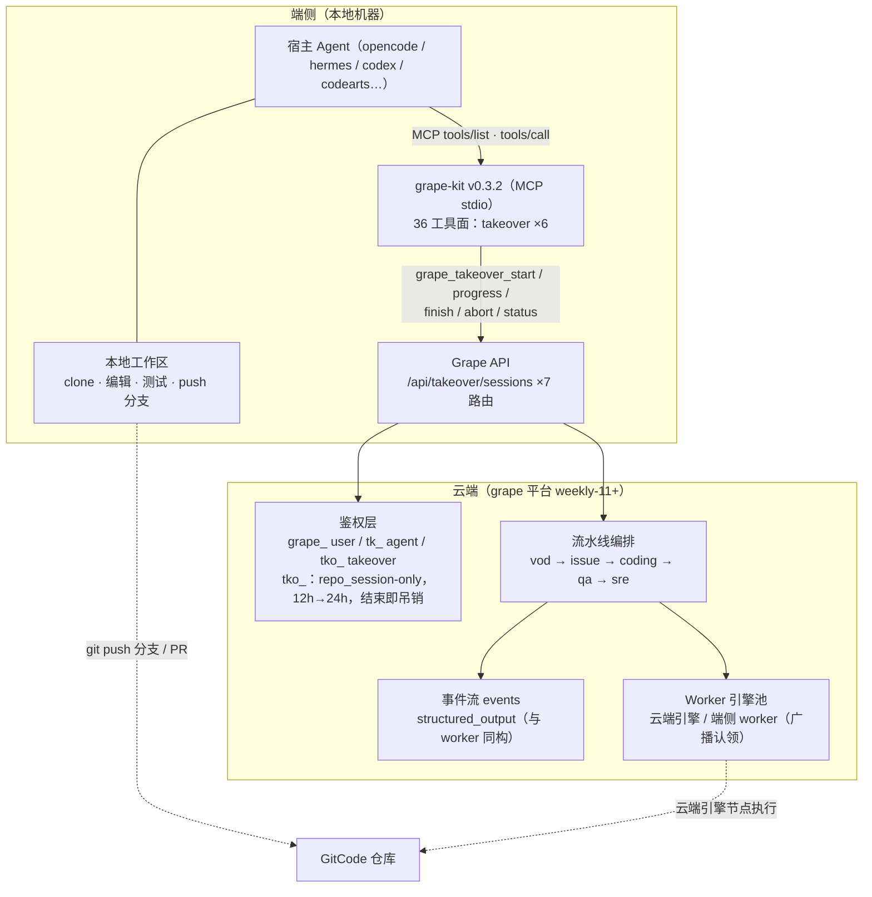
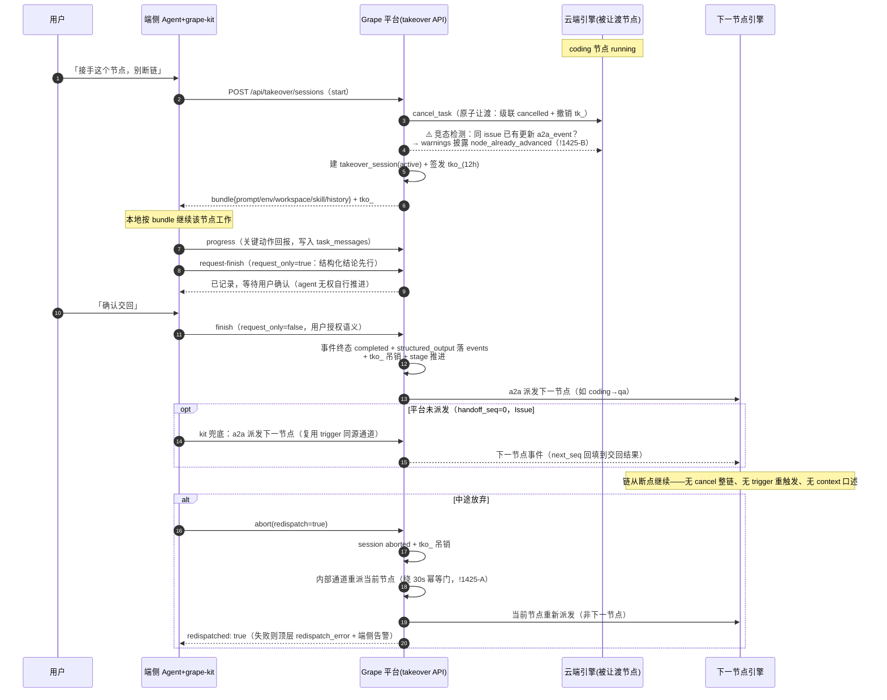

# grape 端云协同 · Takeover 会话原语 —— 架构与验证报告

> 版本基线：grape weekly-11（PR #1268 takeover 一等资源 + #2517 双缺陷修复 !1425）· grape-kit v0.3.2
> 验证实例：本地 weekly-11 实例（sqlite）；跨 agent 测试床（opencode / codex）
> 结论：**端云协同（节点级接管）已完成**——单轮快照式介入升级为会话原语闭环，E2E + 多 agent 实测通过

---

## 1. 总体架构

**三层鉴权分离**（F7 治理延续）：`grape_`（用户，全工具面）、`tk_`（云端节点会话）、`tko_`（接管会话，仅 repo_session 能力、无 user_scope）——接管期间端侧只能碰目标仓，凭据 12h 可续 24h，finish/abort 即吊销。

## 2. 接管全生命周期时序（真接管闭环）

## 3. 与旧路径（v0.3.1 及之前）对比

| 维度 | 旧：cancel+context 口述 | 新：takeover 会话原语 |
|---|---|---|
| 链完整性 | cancel 终止整链，QA/SRE 不交接 | 仅让渡当前节点，链保留 |
| 成果交回 | trigger 重触发 + context 人工口述 | finish 结构化结论（conclusion/actions/artifacts/next_step），与 worker 同构 |
| 凭据 | 用户 grape_ 全权 | tko_ 最小能力（repo_session-only），12h/24h TTL，结束即吊销 |
| 让渡回退 | 无（resume 语义残缺，F9） | abort → 当前节点重派（!1425 后防抖不再拦截） |
| coding↔QA 多轮 | 本地出局，打回循环回云端 | 会话保持 active，多轮驻留 |

### 3.1 finish 的凭据语义（0.3.8 澄清）

`request-finish` 与 `finish` 是**两个不同凭据层**的动作，混用会得到 403 而非业务失败：

| 阶段 | 动作 | 可用凭据 | tko_ 结果 |
|---|---|---|---|
| ① 报告完成 | `POST /sessions/{id}/request-finish` | tko_（接管凭据，repo_session） | 200，仅落「已完成待确认」 |
| ② 用户授权 | 无 API —— **对话中确认**（平台不提供 UI 确认按钮） | 用户本人 | 不适用 |
| ③ 正式交回 | `POST /sessions/{id}/finish` | **用户级凭据 `grape_`** | 403（能力边界，非权限配置错误） |

因此：接管期间的 tko_ 凭据不能自行推进流水线；finish 必须由持有用户级凭据的会话（用户自己的 agent / 平台）执行。kit 侧在 `hintFor(403)` 对该路径给出上述语义提示，避免用户被带向「申请更多权限」。

### 3.2 交回后的下一节点派发（Issue #19）

平台 `finish` 返回 `next_agent=qa` 但 `handoff_seq=0`（#62 实测：事件终态 completed、qa 无事件、`stall_state=grace`）时，链会静默停住。kit 侧 `grape_takeover_finish` 对交回结果做三态收口，保证「链不断」不只是一句描述。

**判据唯一**：派发指针是 `next_seq`（指向平台已写入的下一节点派发事件）。`handoff_seq` 是平台侧交回/handoff 事件序号，只作披露、**不作为「已派发」证据**——`handoff_seq>0` 而 `next_seq=0` 按「交回已写、派发未证实」兜底补发并留 ⚠️ 告警。

| 交回结果 | kit 行为 | 渲染 |
|---|---|---|
| `next_seq` > 0 | 平台已派发，**不重复派发** | `已由平台派发（next_seq=N）` |
| `next_seq=0` 且 `next_agent=qa`（或当前节点 `coding` 推导 coding→qa），无阻塞 | **兜底补发**一次 A2A（复用 trigger 同源 `/api/a2a`），回填 `next_seq` | `已自动派发（seq=N）` |
| `next_seq=0` 且目标不在 coding→qa 范围（vod/issue/qa 等节点） | 不改其它节点派发行为（Spec Out of Scope），只如实披露 | `兜底范围仅 coding→qa` |
| `remote_may_still_run` 等警告码、`skipped_dispatches>0`、缺 owner/repo/issue_number 标识、补发失败 | 不瞎派：`dispatch.status=pending` + `pending_dispatch{agent,owner,repo,issue_number,reason}` 随交回结果返回。**标记不走 task_messages**——finish 在服务端同步关会话，事后向已结束会话写 progress 必 409 not_active（mgmt 路由实测）；标记由**会话记录派生**：`grape_takeover_status` 对已结束会话仍可查，`finished + next_agent + 派发指针 next_seq=0` 即派发未证实（仅 `handoff_seq>0` 不作已派发证据，降级为「交回已写、派发未证实」并提示先核实事件），渲染给出目标/原因/补发指引 | 显式告警 + `grape_trigger_pipeline(agent=…)` 补发指引（补发前先 `grape_get_issue_events` 核实，防兜底已成功时重复派发） |

**交回成功度前置（未成功不派发）**：上表的兜底只在交回**本身成功**之后才有意义。平台返回 `ok=false`（可达面：`200 + ok:false`，以及 `401` 经 CLI 回退包装成 `ok:false`）或 `changed=false`（未真正落账）时，kit **不派发**下一节点——否则下一节点会接手一个未交回的任务，属「部分成功当全部成功」的同一类错；此时落 `dispatch.status=pending`、渲染「交回未成功」、标题写「交回未完成」，不再输出「链不断／无需手动 trigger」。

**「未给」与「不认识」是两件事**：平台 `next_agent` 为空或缺省 → 按场景链 coding→qa 兜底（正常路径）；平台给了**白名单外**节点名（实测 `reviewer`）→ kit 不把平台决定顶掉改写成 qa，原样上报「未知节点」并落 `pending` 待人工裁决。`next_step` 的散文不算「给了节点名」，仍按场景链兜底。

**补发未证实不判成功**：兜底 A2A 响应缺事件 `seq`（200 形态 `{}`）时 `dispatch.status=pending`（`cause=dispatch_unconfirmed`），转人工查事件核实——不渲染 `seq=0`、不宣称「已自动派发」。

**派发目标口径**：`issue_number` 才是单号；平台 `/tasks` 的 `issue.id`（#19 实测 `18808`）是内部主键，**不能**当 `issue_number` 兜底，否则派发会打到错误 issue。会话未带仓库标识时用 `owner`/`repo`/`issue_number` 入参补齐；平台未给下一节点且不在兜底范围（如 qa 交回、非 coding 节点）返回 `no_next_node` 或 `out_of_scope`，属正常收尾。**会话未带 `agent_type` 时同样按 `out_of_scope` 处理**：无当前节点标识就无法确认兜底范围（coding→qa），宁可不派、由渲染如实披露，不静默。`out_of_scope` 渲染另提示「平台若未派发则该节点会停在当前节点」，不给「无需 trigger」的错觉。

**待派发的阻塞判据**：只认警告**稳定码**（`remote_may_still_run` / `branch_conflict` / `merge_conflict`，取 `code:` 前缀精确匹配）。不匹配散文子串——「branch_sync: 远端无冲突」含「冲突」二字但不阻塞；平台 warnings 是稳定 code 列表，按码匹配不漏不误伤。

**验收口径修正**：兜底路径只回填 `next_seq`，`handoff_seq` 由平台写入、本工具不写——AC 中「`handoff_seq`/`next_seq` 非 0」按「派发指针 `next_seq` 非 0」读取。`next_step` 仅整串 agent 名（如 `qa`）命中，散文（如「qa：请复查 PR #10」）不解析，由场景链 coding→qa 兜底。

### 3.3 技能物化（Issue #28）

接管 prompt 声称「技能已物化，直接读 SKILL.md」，而此前 `grape_takeover_start` 对 `bundle.assets.skill` 零引用——目录实际不存在（接管链路首个断点）。现由 `src/skill-materialize.mjs` 承接：

| 态 | 输入 | 行为 |
|----|------|------|
| inline | `assets.skill.files`（数组或「路径→内容」映射） | 逐条目落盘到 `<cwd>/.grape-takeover-skills/<skill>/` |
| zip | `assets.skill.zip_url` | 零依赖解压（`zlib.inflateRawSync` + 最小 ZIP 解析，仅 store/deflate），剥离 `<skill>/` 顶层前缀 |
| legacy | 无 `assets.skill`（旧平台） | 不落盘，渲染显式提示「本次未物化技能」 |

- **时机**：物化在 `native()` 后置执行，结果挂 `json.skillMaterialization`；`render()` 保持同步纯函数，只读该字段（`test/takeover-hardening.test.mjs` 的同步直调 seam 不受影响）。
- **目录口径**：`cwd = bundle.workspace.cwd_hint || process.cwd()`，与接管脚本 `{{CWD}}` 同源。
- **失败语义**：会话已建立即保留——物化失败不外抛、不回滚，`status:'failed'` + reason 进渲染 warning；仅当目标目录由本次调用新建时才清理半成品。
- **安全**：技能名白名单 `^[A-Za-z0-9][A-Za-z0-9._-]{0,63}$`（拒 `.`/`..`/`.skills`/分隔符与盘符，不归一化）；条目拒 `..`、绝对路径、反斜杠盘符、`.skills` 段；逐级 `lstat` 拒符号链接（含 zip `S_IFLNK` 条目）；落盘前缀校验；恒不写 `.skills/`。

## 4. 验证矩阵（全部真机）

| 验证项 | 环境 | 结果 |
|---|---|---|
| 单测 | weekly-11 + !1425 | 123 passed 零回归（新增 7 用例） |
| E2E 全链（start→progress→request-finish→finish→qa 接力） | 本地实例 #18/#19 | ✅ 链自动推进到 qa |
| abort 让渡→重派 | 同上 #20 | ✅ 节点重派 running |
| #2517-A 重放（幂等键 <30s 下 abort） | 同上 #21 | ✅ redispatched=true、事件回 running |
| #2517-B 重放（更新 a2a_event 下 start） | 同上 #21 | ✅ 200 + node_already_advanced 警告 |
| 自然语言卡 A1/A2/A3/B4/B5 | 本地实例 opencode | ✅ 全绿，两阶段纪律（request→确认→finish）生效 |
| 跨 agent（SSH 隧道，零端口开放） | 测试床 opencode | ✅ B8/A1/C6 |
| 跨 agent | 测试床 codex 0.90.0 | ✅ B8 + 克制卡（未接管、决策门声明） |

## 5. 遗留与边界

- **内置 Node 接管脚本**：`skills/grape-remote/scripts/takeover/{report,request-finish,finish}.mjs` 随 `skills/` 目录分发（Node ≥20，Windows/Linux 通用）；token 只从环境变量读取，不进入 argv/历史。
- **技能物化（#28）**：`<cwd>/.grape-takeover-skills/<skill>/` 是物化产物目录，随工作区存在；`.skills/` 恒不写（worker 会 rmtree）。Windows 路径口径由 `resolve` + `path.sep` 前缀校验覆盖，条目含 `\` 一律拒绝。
- **tko_ 不含 git 凭据注入**：接管期间的回推依赖宿主已有用户级凭据（`grape git` 注入 / 自有 PAT / SSH key）；洁净机器需用户先配置。kit 在 `grape_takeover_start` 返回体显式披露该边界（0.3.8）。
- **生产未部署**：weekly-11（含 #1268 + !1425）未上 www.grapedev.cn——takeover 工具面在生产 404 属预期，grape-kit 已按 404 回退老路径并提示
- **!1425 待合入**：修复在分支，PR 审核后随 weekly-11 发版列车走（与 #2238/2.4.0 同列）
- npm v0.3.2 发布待 granular token（用户操作）
- 外部 agent 的 API key 经宿主 config 注入（env 通道，不落盘、不外显）

## 6. 分叉裁决 playbook（takeover 前置）

`grape_takeover_start` 的 warnings 是**动手前的裁决输入**，kit 会全量透出为前置检查清单（不再取前 5 条、不再截断）。典型两类：

| 警告 | 含义 | 裁决动作 |
|---|---|---|
| `remote_may_still_run` | 云端 worker 在被杀前可能已推送目标分支、甚至已开 MR | 先 `git ls-remote origin <branch>` + 查 issue 事件/MR 列表，再按下方三选一 |
| `node_already_advanced` | 链已交棒下一节点，本次接管与其并行 | 先看 issue 事件确认下一节点产物，避免重复实现；交回前对齐 |

### 远端分叉三种处置

1. **复用远端分支（推荐）**：`git fetch origin <branch>` 后基于远端最新提交继续；本地已有提交则 rebase 到远端，保留双方成果。
2. **rebase 后强推**：仅当确认远端提交是本次要取代的半成品，且**用户明确确认**后才 `push --force-with-lease`；禁止裸 `--force`。
3. **另起分支**：`feat/issue-N-local` 等独立分支开发，交回时在结论中写明分支名与关系，由 QA/SRE 决策合并路径。

已有 MR 时，先读 MR 讨论与 CI 结果，再决定在其上追加提交还是新开 MR；不要在 MR 已合并的情况下重复推送同一实现。

> 上游若在 `takeover_start` 返回目标分支远端状态/已有 MR 字段，kit 渲染会自动兼容展示；在字段上线前以上述前置检查为准。
