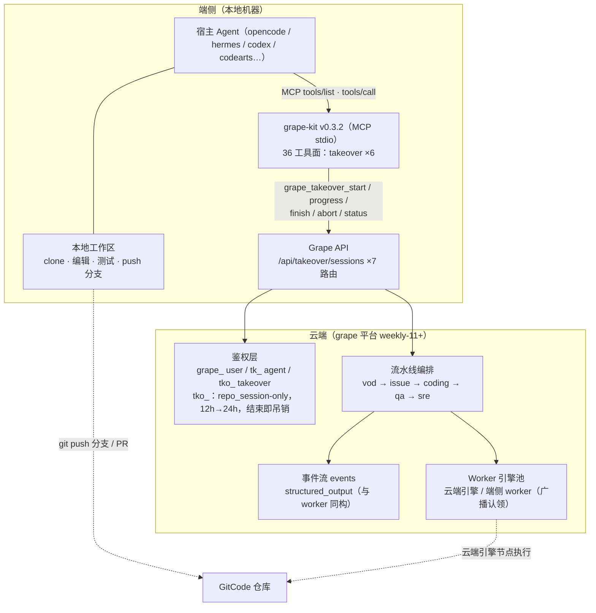
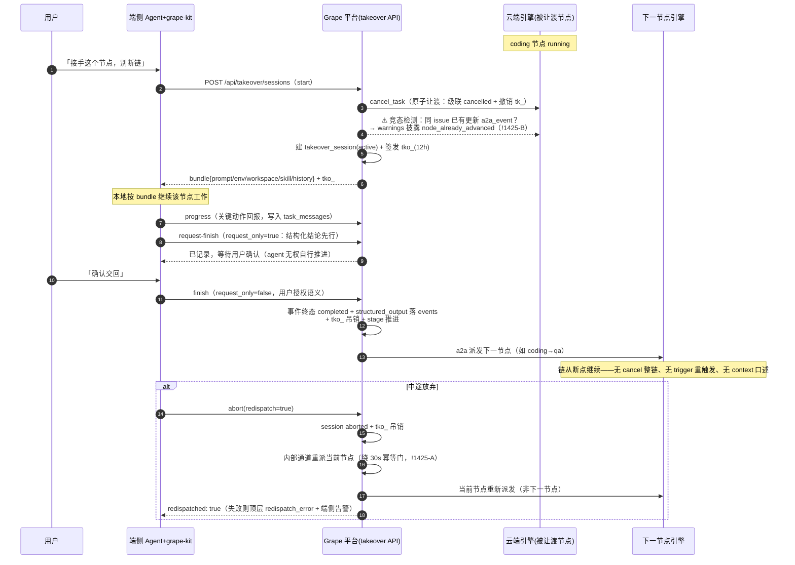

# grape 端云协同 · Takeover 会话原语 —— 架构与验证报告

> 版本基线：grape weekly-11（PR #1268 takeover 一等资源 + #2517 双缺陷修复 !1425）· grape-kit v0.3.2
> 验证实例：本地 weekly-11 实例（sqlite）；跨 agent 测试床（opencode / codex）
> 结论：**端云协同（节点级接管）已完成**——单轮快照式介入升级为会话原语闭环，E2E + 多 agent 实测通过

---

## 1. 总体架构

**三层鉴权分离**（F7 治理延续）：`grape_`（用户，全工具面）、`tk_`（云端节点会话）、`tko_`（接管会话，仅 repo_session 能力、无 user_scope）——接管期间端侧只能碰目标仓，凭据 12h 可续 24h，finish/abort 即吊销。

## 2. 接管全生命周期时序（真接管闭环）

## 3. 与旧路径（v0.3.1 及之前）对比

| 维度 | 旧：cancel+context 口述 | 新：takeover 会话原语 |
|---|---|---|
| 链完整性 | cancel 终止整链，QA/SRE 不交接 | 仅让渡当前节点，链保留 |
| 成果交回 | trigger 重触发 + context 人工口述 | finish 结构化结论（conclusion/actions/artifacts/next_step），与 worker 同构 |
| 凭据 | 用户 grape_ 全权 | tko_ 最小能力（repo_session-only），12h/24h TTL，结束即吊销 |
| 让渡回退 | 无（resume 语义残缺，F9） | abort → 当前节点重派（!1425 后防抖不再拦截） |
| coding↔QA 多轮 | 本地出局，打回循环回云端 | 会话保持 active，多轮驻留 |

### 3.1 finish 的凭据语义（0.3.8 澄清）

`request-finish` 与 `finish` 是**两个不同凭据层**的动作，混用会得到 403 而非业务失败：

| 阶段 | 动作 | 可用凭据 | tko_ 结果 |
|---|---|---|---|
| ① 报告完成 | `POST /sessions/{id}/request-finish` | tko_（接管凭据，repo_session） | 200，仅落「已完成待确认」 |
| ② 用户授权 | 无 API —— **对话中确认**（平台不提供 UI 确认按钮） | 用户本人 | 不适用 |
| ③ 正式交回 | `POST /sessions/{id}/finish` | **用户级凭据 `grape_`** | 403（能力边界，非权限配置错误） |

因此：接管期间的 tko_ 凭据不能自行推进流水线；finish 必须由持有用户级凭据的会话（用户自己的 agent / 平台）执行。kit 侧在 `hintFor(403)` 对该路径给出上述语义提示，避免用户被带向「申请更多权限」。

## 4. 验证矩阵（全部真机）

| 验证项 | 环境 | 结果 |
|---|---|---|
| 单测 | weekly-11 + !1425 | 123 passed 零回归（新增 7 用例） |
| E2E 全链（start→progress→request-finish→finish→qa 接力） | 本地实例 #18/#19 | ✅ 链自动推进到 qa |
| abort 让渡→重派 | 同上 #20 | ✅ 节点重派 running |
| #2517-A 重放（幂等键 <30s 下 abort） | 同上 #21 | ✅ redispatched=true、事件回 running |
| #2517-B 重放（更新 a2a_event 下 start） | 同上 #21 | ✅ 200 + node_already_advanced 警告 |
| 自然语言卡 A1/A2/A3/B4/B5 | 本地实例 opencode | ✅ 全绿，两阶段纪律（request→确认→finish）生效 |
| 跨 agent（SSH 隧道，零端口开放） | 测试床 opencode | ✅ B8/A1/C6 |
| 跨 agent | 测试床 codex 0.90.0 | ✅ B8 + 克制卡（未接管、决策门声明） |

## 5. 遗留与边界

- **tko_ 不含 git 凭据注入**：接管期间的回推依赖宿主已有用户级凭据（`grape git` 注入 / 自有 PAT / SSH key）；洁净机器需用户先配置。kit 在 `grape_takeover_start` 返回体显式披露该边界（0.3.8）。
- **生产未部署**：weekly-11（含 #1268 + !1425）未上 www.grapedev.cn——takeover 工具面在生产 404 属预期，grape-kit 已按 404 回退老路径并提示
- **!1425 待合入**：修复在分支，PR 审核后随 weekly-11 发版列车走（与 #2238/2.4.0 同列）
- npm v0.3.2 发布待 granular token（用户操作）
- 外部 agent 的 API key 经宿主 config 注入（env 通道，不落盘、不外显）
